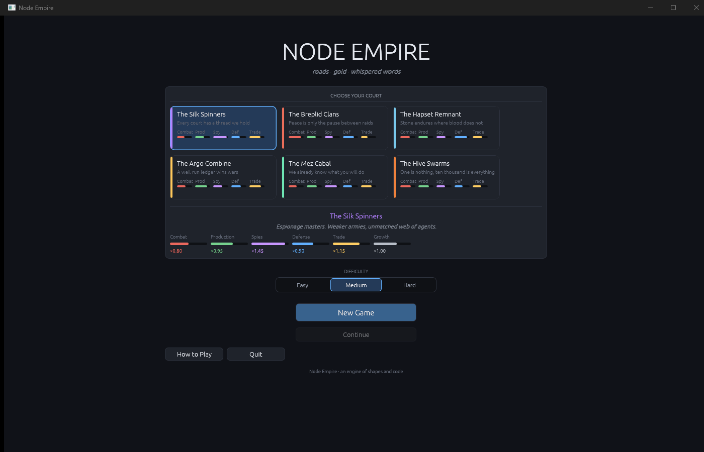
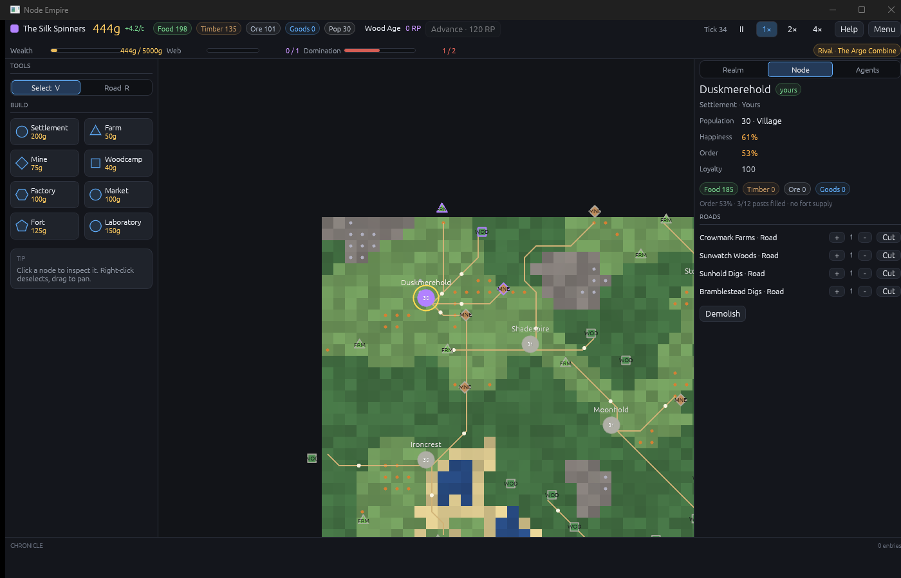

# Node Empire

[](https://discord.gg/TquJzY24Ea)
[](LICENSE)

A realtime strategy game about **roads, villages, garrisons and spies**. You
begin with one village and a few fields, and expand by connecting the map:
claim nodes, staff them, keep the peace, and take the rest by trade, influence,
or force.

Built on [Bevy](https://bevyengine.org) 0.20 with **zero art assets**. Every
visual is a shape drawn in code or a procedural texture generated at startup;
the only file in `assets/` is a WESL shader compiled into the binary with
`include_str!`. All text is drawn by egui.

> **Current state: single-player alpha (v0.3.0).** The simulation is real and
> tested; the content is thin. There are two real powers plus neutral villages,
> six court profiles that are stat multipliers (not asymmetric factions), one AI
> opponent, no audio, and placeholder procedural visuals. This is not a Seven
> Kingdoms remake or clone. The honest inventory is
> [`docs/MECHANICS.md`](docs/MECHANICS.md); what is still missing is
> [`ROADMAP.md`](ROADMAP.md).




## Play

```bash
git clone https://github.com/Alcartez/Node-Empire.git
cd Node-Empire
cargo run --release
```

Rust **1.98** is pinned by `rust-toolchain.toml` (install via
[rustup](https://rustup.rs/)). Windows needs the MSVC build tools. Saves are
plain JSON in `saves/` next to the working directory; the autosave runs every
600 ticks.

Controls: `WASD`/drag pan, wheel zoom, `LMB` select or place, `RMB` cancel,
`Space` pause, `1/2/3` speed, `V` select tool, `R` road tool, `0` quick-save,
`H` help, `Esc` back.

## What works today

Every ✅ row is backed by a test in `tests/`.

| System | Status | Evidence |
|---|---|---|
| Procedural 120×90 map, viable start on 200 seeds | ✅ | `spawn.rs`, `suite_invariants.rs` |
| Roads, A* pathing, caravans, production chain | ✅ | `economy.rs`, `sim_stress.rs` |
| Public order, happiness, growth gates | ✅ | `economy.rs` |
| Garrisons, supply roads, tier caps | ✅ | `economy.rs`, `sim_stress.rs` |
| Auto-employment of connected buildings | ✅ | `suite_auto_employ.rs` |
| Manual worker training and skill growth | ✅ | `suite_training.rs` |
| Generals: salary, loyalty, mutiny, fort defense & town loyalty aura | ✅ | `suite_generals.rs` |
| Fort equipment tiers: gold + goods, supply-gated | ✅ | `suite_equipment.rs` |
| Node war: fort battles, siege investment, supply pressure | ✅ | `suite_combat.rs` |
| Races as passive multipliers | ✅ | `suite_demographics.rs` |
| Neutral fealty, tiers, peaceful integration | ✅ | `suite_fealty.rs` |
| Save/load with schema back-compat | ✅ | `economy.rs`, `suite_invariants.rs` |
| Influence, petitions, buy/foment | 🟡 thin: works, no dedicated suite | — |
| Espionage, bandits | 🟡 thin: stress-tested only | — |
| Victory conditions | 🟡 thin: simple predicates, no direct test | — |
| Six courts | 🟡 stat profiles only; no unique units or buildings | — |
| Audio, diplomacy, multi-faction, migration | ❌ not implemented | — |

Legend: ✅ shipped and tested · 🟡 works but thin · ❌ not implemented.

## Known limitations

- **The fealty dividend has no cost or decay.** A Trading Partner road pays +3
  gold per delivery forever, which is a slow money printer. Fix is scheduled for
  M1.
- **Espionage and influence are under-tested.** They run in the long stress
  simulation, but there is no focused suite yet.
- **One opponent, one map type.** The map is always 120×90 and the enemy is a
  single AI faction with a difficulty setting.
- **Courts are not asymmetric.** The six profiles change multipliers and
  happiness; they do not add units, buildings, or abilities.
- **No audio, fog of war, diplomacy, or multiplayer.**
- **General salary is a flat 15 gold** and unpaid loyalty drops by 6 per upkeep
  cycle. Balance work on command is scheduled for M2.

## Design pillars

1. **Set the network, watch it grow, respond to events.** The player is a
   network architect, not a unit micromanager.
2. **Connection is claim.** A road is ownership, logistics, and politics at once.
3. **Soft power is real power.** Trade and influence can absorb a village
   without a battle.
4. **Command has a price.** Generals are useful and disloyal; spies are cheap and
   deniable.

The long-term fantasy — and an explicit list of what is **not** implemented — is
in [`docs/VISION.md`](docs/VISION.md).

## Documentation

| Document | Contents |
|---|---|
| [`ROADMAP.md`](ROADMAP.md) | The only roadmap: status legend, M0–M5, open decisions |
| [`docs/MECHANICS.md`](docs/MECHANICS.md) | Every implemented rule, constant, and formula |
| [`docs/ARCHITECTURE.md`](docs/ARCHITECTURE.md) | Simulation/presentation split, tick order, rendering, saves |
| [`docs/TESTING.md`](docs/TESTING.md) | Harness, suites, commands, coverage rules |
| [`docs/SETUP.md`](docs/SETUP.md) | Toolchain install on Windows, Linux, macOS |
| [`docs/PLAYTESTING.md`](docs/PLAYTESTING.md) | Manual QA checklist and diagnostics |
| [`docs/VISION.md`](docs/VISION.md) | Long-term design intent (not a feature list) |
| [`docs/RESEARCH_7K.md`](docs/RESEARCH_7K.md) | Seven Kingdoms mechanics study and status |
| [`docs/design/factions.md`](docs/design/factions.md) | The six implemented courts |
| [`CONTRIBUTING.md`](CONTRIBUTING.md) | Workflow and architectural invariants |
| [`CONTRIBUTORS.md`](CONTRIBUTORS.md) | Credits and contribution terms |

## Contributing

Read [`CONTRIBUTING.md`](CONTRIBUTING.md). Before opening a PR, run:

```bash
cargo fmt --check
cargo clippy --all-targets -- -D warnings
cargo test
```

The simulation layer (`src/game/`) is pure Rust with no Bevy imports, so almost
everything is testable headlessly. New mechanics need a test; new UI needs a
playtest step.

## Licence

Copyright (C) 2026 the Node Empire authors.

Node Empire is free software under the **GNU General Public License v3.0 or
later** (`GPL-3.0-or-later`). See [`LICENSE`](LICENSE). Contributions are
accepted under the same licence (inbound = outbound).

### Relationship to Seven Kingdoms

Node Empire is an **independent implementation**. No Seven Kingdoms source code,
strings, artwork, data files, or other assets are included in the build. The
mechanics were studied from the freely published GPL-2.0 sources of *Seven
Kingdoms* / *Seven Kingdoms II* (7KAA and 7K-Ambition, via
[7kfans.com](https://www.7kfans.com)); those clones live only in the gitignored
`scratch/` directory as read-only references and are never compiled, linked, or
shipped. Because no code is copied or adapted, the GPL-2.0 and GPL-3.0 licences
do not interact.

"Seven Kingdoms" and "Seven Kingdoms II" are trademarks of their owners and are
used only to describe the design inspiration. Node Empire is not affiliated
with, endorsed by, or supported by Trevor Chan, Enlight Software, or the 7kfans
project.

### Third-party dependencies

Bevy, egui, serde, and the other crates in `Cargo.lock` are used under their own
licences (Bevy and egui are dual MIT / Apache-2.0), all compatible with
GPL-3.0-or-later distribution. `Cargo.lock` is committed so builds are
reproducible.
