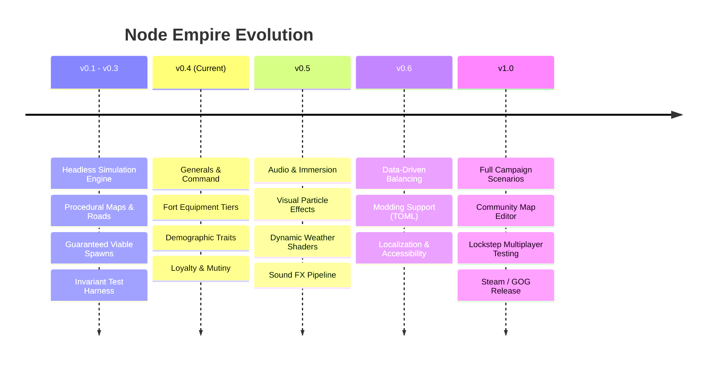

# Node Empire — Development Roadmap 🗺️

**Current Version:** `v0.3.0` (Alpha)  
**Engine:** Bevy 0.20 + egui 0.43 (Rust 1.85+)  
**Core Thesis:** *An Idle Empire Engine with a Game-of-Thrones Heart* — zero art asset overhead, indirect graph control, high-stakes leadership, and deep espionage.

---

## 🎯 High-Level Vision & Milestones

---

## 📍 Milestone Overview

### ✅ Phase 1: Foundation & Civic Core (v0.1 – v0.3)
- [x] **Headless Deterministic Simulation**: Engine-agnostic core in `src/game/` running without GPU/windowing.
- [x] **A* Road Networking**: Dynamic roads pathfinding around terrain; automated caravan dispatch.
- [x] **Civic Order & Growth Formula**: Balanced employment and fort supply requirements preventing runaway snowballing.
- [x] **Procedural Generation Guarantees**: Guaranteed starter ring (farm, woodcamp, mine, roads) across 200+ tested seeds.
- [x] **Single-Asset Shading**: Custom WESL procedural shimmer shader compiled directly into the binary.
- [x] **Save / Load Stability**: `serde_json` serialization with backward compatibility across schema updates.

---

### 🔨 Phase 2: Generals, Demographics & Military Overhaul (v0.4 — Active Milestone)

> **Objective:** Transition from abstract numbers into personal, high-stakes character drama inspired by *Seven Kingdoms*.

- [x] **Named Generals System (`game/types.rs`)**:
  - [x] General struct with `leadership`, `combat`, `loyalty`, `salary`, and `race`.
  - [x] Starter General spawn at game start (*Founding Champion*).
- [x] **Fort Equipment Progression (`tests/suite_equipment.rs`)**:
  - [x] Tiers 0–3 (Militia, Bronze, Iron-Clad, Folded Steel).
  - [x] Factory/Blacksmith logistical supply chain linking to forts.
- [x] **Macro Racial Demographics (`tests/suite_demographics.rs`)**:
  - [x] Dominant settlement races (Humans, Beetlefolk, Hive Swarms, Silk Spinners, Reptilians).
  - [x] Same-race governance harmony (+loyalty, +order) vs alien rule friction.
  - [x] Racial combat and consumption traits (e.g., Reptilian food conservation, Hive swarm density).
- [x] **Mutiny & Loyalty Pipeline (`game/sim.rs`)**:
  - [x] Salary upkeep checks; wage debt causes gradual loyalty degradation.
  - [x] Treacherous loyalty (< 20) triggers mutiny risks and fort rebellion.
- [ ] **UI Polish & Strategic Panels (`src/engine/ui.rs`)**:
  - [ ] Interactive Generals inspect sheet in Realm/Node tabs.
  - [ ] Visual indicator rings for Generals on the world map.
  - [ ] "Bribe / Bestow Title" action buttons in the UI.

---

### 🎨 Phase 3: Audio, Sensory Feedback & Visual Polish (v0.5)

> **Objective:** Breathe life into the minimalist, zero-art aesthetic through procedural audio and dynamic shader effects.

- [ ] **Audio Architecture (`bevy_audio` / `rodio` / `kira`)**:
  - [ ] Ambient background landscape music (adaptive procedural drones / melodic medieval themes).
  - [ ] Sound cues: Road placement clicks, coin collection chimes, battle drums, mutiny warning horns.
  - [ ] Directional map panning audio based on camera position.
- [ ] **Procedural FX & Shaders**:
  - [ ] Visible marching caravans: mini worker silhouettes walking road ribbons.
  - [ ] Combat dust and siege arrow particles using Bevy gizmos/sprites.
  - [ ] Day/Night lighting cycle or seasonal tint shifts in `terrain.wesl`.
- [ ] **UI Animation & Sound**:
  - [ ] Animated meter fills and toast notification transitions.

---

### 📜 Phase 4: Data-Driven Modding & Content Customization (v0.6)

> **Objective:** Empower the community to balance, mod, and create custom factions without compiling Rust code.

- [ ] **Externalized Configs (`data/` TOML files)**:
  - [ ] `factions.toml`: Define custom factions, colors, and species trait modifiers.
  - [ ] `buildings.toml`: Costs, capacities, employment requirements, and production rates.
  - [ ] `equipment.toml`: Armament tiers and upgrade recipes.
- [ ] **Hot-Reloading for Designers**:
  - [ ] Live-reload config data in debug mode without restarting the game.
- [ ] **Scenario & Map Generation Seeds**:
  - [ ] Custom challenge maps (e.g., Island Archipelagos, Resource Scarcity, Desert Wastes).

---

### 🌐 Phase 5: Multiplayer & Long-Term Horizons (v1.0+)

> **Objective:** Expand Node Empire into a competitive or co-op multiplayer experience and commercial release.

- [ ] **Deterministic Lockstep Networking**:
  - [ ] Leverage existing headless, deterministic tick simulation.
  - [ ] Client/Server command dispatch queue (`Action` serialization).
- [ ] **Steam / GOG Packaging**:
  - [ ] Cloud saves, achievements, and Steam Deck controller navigation.
- [ ] **Community Translation & Localization**:
  - [ ] Fluent / gettext integration for global community translations.

---

## 💡 How You Can Help

Check out [`CONTRIBUTING.md`](CONTRIBUTING.md) to pick up tasks from our active milestones. If you have an idea that isn't on this roadmap, open a **Feature Proposal** discussion on GitHub!
