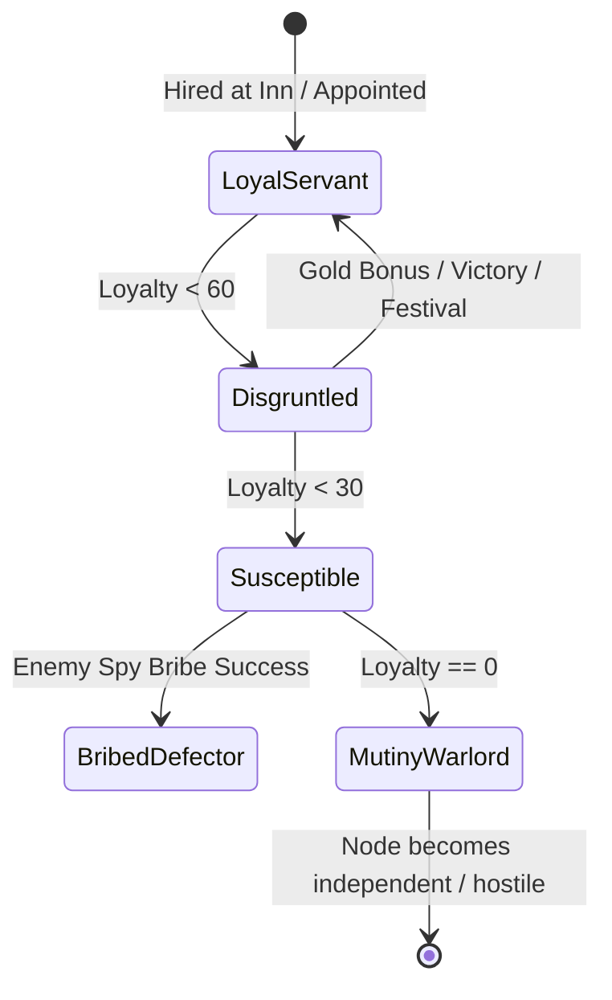
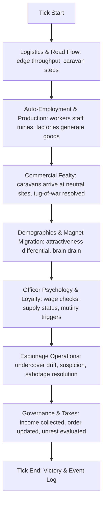

# Node Empire: Systems Specification Document

This document provides the formal technical and mechanical specification for Node Empire's transition into the definitive modern, indirect successor to *Seven Kingdoms* and *Rise of Nations: Rise of Legends*.

---

## 1. Architectural Philosophy: The Sovereign's Perspective

In traditional RTS games, the player is an omniscient battlefield manager clicking individual soldiers and workers. In Node Empire, the player is the **Sovereign of the Realm**:
- **Macro Levers:** You set tax policies, establish road corridors, commission public works, conduct diplomacy, appoint commanders, and order covert operations.
- **Autonomous Circulation:** The graph is the living circulatory system of your empire. Workers migrate to open jobs, trade caravans seek lucrative markets, supply carts deliver military rations, and cultural influence radiates along paved highways.
- **Indirect Command:** You do not micro-manage hundreds of individual peasants; you align economic, military, and civilian incentives so the world naturally flows toward your imperial ambitions.

---

## 2. System 1: Commercial Fealty & Neutral Allegiance Engine
*(Inspired by Rise of Nations: Rise of Legends)*

The world is not an empty landscape waiting to be cleared. It is populated by independent tribes, merchant enclaves, and monastic orders. Players compete economically and diplomatically to win their fealty.

### 2.1 Data Structures (`types.rs`)

```rust
use std::collections::HashMap;
use serde::{Serialize, Deserialize};

pub type FactionId = u8;

#[derive(Debug, Clone, Serialize, Deserialize)]
pub struct NeutralSite {
    pub id: u32,
    pub name: String,
    pub culture: Culture,
    pub specialty: NeutralSpecialty,
    pub fealty: HashMap<FactionId, f32>, // FactionId -> score in range [0.0, 100.0]
    pub active_levy_commander: Option<FactionId>,
    pub base_garrison: i32,
}

#[derive(Debug, Clone, Copy, PartialEq, Eq, Serialize, Deserialize)]
pub enum AllegianceTier {
    /// 0..24 Fealty: Basic trade allowed, standard edge toll applies.
    WaryNeutral,
    /// 25..49 Fealty: +25% trade tariff profits, shared fog-of-war sight around site.
    TradingPartner,
    /// 50..84 Fealty: Player can command the site's unique auxiliary military unit!
    AlliedProtector,
    /// 85..100 Fealty: Voluntary peaceful integration; site joins kingdom permanently.
    IntegratedDomain,
}

impl NeutralSite {
    pub fn tier_for(&self, faction: FactionId) -> AllegianceTier {
        let score = self.fealty.get(&faction).copied().unwrap_or(0.0);
        if score >= 85.0 {
            AllegianceTier::IntegratedDomain
        } else if score >= 50.0 {
            AllegianceTier::AlliedProtector
        } else if score >= 25.0 {
            AllegianceTier::TradingPartner
        } else {
            AllegianceTier::WaryNeutral
        }
    }
}

#[derive(Debug, Clone, Copy, Serialize, Deserialize)]
pub enum NeutralSpecialty {
    HighlandNomads,   // Grants swift Outrider Cavalry (high sight, road raiding)
    IronGuild,        // Grants Siege Engineers (+35% fort breach efficiency)
    MysticOrder,      // Grants Healers/Alchemists (+passive Order & attrition recovery)
    RiverCorsairs,    // Grants amphibious caravans & toll evasion
    SteppeArchers,    // Grants composite archers with armor-piercing skirmish
}
```

### 2.2 Mathematical Formulas: Fealty & Commercial Tug-of-War

Fealty is earned dynamically as trade caravans arrive at the neutral site:

$$\Delta \text{Fealty}_A = \text{CaravanDeliveryValue} \times \left(1.0 + \frac{\text{Reputation}_A - 50}{100}\right) \times \text{CultureMatchBonus}$$

- $\text{CaravanDeliveryValue}$: High-tier manufactured goods (Tools, Weapons, Luxury Pottery) award **$3\times$** more fealty than raw wheat or timber.
- $\text{Reputation}_A$: A righteous sovereign (Reputation $> 80$) accumulates fealty up to $+30\%$ faster. A known tyrant (Reputation $< 30$) suffers up to $-40\%$ penalty.
- $\text{CultureMatchBonus}$: $+25\%$ if the sovereign or assigned merchant shares the tribe's culture.

#### The Zero-Sum Tug-of-War Decay
When multiple factions connect roads to the same neutral site, fealty becomes an economic tug-of-war:
$$\text{Fealty}_B \leftarrow \max(0.0,\; \text{Fealty}_B - (\Delta \text{Fealty}_A \times 0.20))$$
- Every point gained by Faction $A$ erodes the influence of Faction $B$.
- **Counterplay & Trade Interdiction:** Faction $B$ can raid Faction $A$'s caravans along the highway or place a Fort with an embargo to sever $A$'s fealty pipeline.

### 2.3 Commandable Levies (Tier 2: Allied Protector)
When reaching 50+ Fealty:
1. The **"Call Levies"** order activates on the neutral node.
2. The neutral site spawns its faction-specific unit (e.g., 8 Highland Outriders or a Siege Engine) bound to the player's banner.
3. The player issues strategic targets along the graph (e.g. "Patrol Trade Corridor", "Raid Enemy Supply Route", "Join Garrison at Fort").
4. **Loyalty Condition:** If competing trade drops the player's fealty below 50, the levies break off and return to their ancestral home.

---

## 3. System 2: Physical Graph Logistics (Vascular Flow)

Roads in Node Empire are not static visual connectors; they are physical conduits with throughput limits, transit speeds, and security levels.

### 3.1 Edge Architecture

```rust
#[derive(Debug, Clone, Serialize, Deserialize)]
pub struct Edge {
    pub id: u32,
    pub from: u32,
    pub to: u32,
    pub tier: RoadTier,
    pub length: f32,
    pub security_rating: f32, // 0.0 (lawless/infested) .. 1.0 (impenetrable patrol)
    pub active_blockade: Option<FactionId>,
    pub toll_tariff_rate: f32, // e.g. 0.05 (5% value collected from foreign caravans)
}

#[derive(Debug, Clone, Copy, PartialEq, Eq, Serialize, Deserialize)]
pub enum RoadTier {
    DirtTrail,    // Speed: 1.0x | Max Packet Cap: 3  | Bandit Risk: High
    GravelHighway,// Speed: 1.7x | Max Packet Cap: 7  | Bandit Risk: Low
    RoyalPavement,// Speed: 2.5x | Max Packet Cap: 15 | Influence Radius: +50%
}
```

### 3.2 Supply Pulses & Military Attrition
Forts and armies in the field consume **Logistical Rations**:

```
[Friendly Settlement / Granary] ===(Supply Edge)====> [Frontier Fort]
                                      |
                              If Edge Severed:
                        Supply Reserves: 100 -> 0
                                      |
                          Reserve == 0 triggers:
                   Garrison Morale: -2 per tick (Starvation)
                   Troop Desertion: -1 soldier per 15 ticks
                   Mutiny / Surrender Risk: EXTREME
```

- **Supply Lines:** Every 10 ticks, a settlement checks all connected Forts. If a path exists through friendly or neutral (open border) edges, the fort's `supply_reserve` is replenished to 100.
- **The Chokepoint Siege:** To conquer a mountain citadel, you do not need to throw thousands of lives at high walls. You occupy or destroy the road connecting the fort to its grain supply. Within 120 seconds of real-time play, the starved garrison will wave the white flag or open the gates.

---

## 4. System 3: The Officer & Loyalty State Machine

Military and civic authority is delegated to named **Officers** who possess distinct leadership traits, loyalty, and ambition.

### 4.1 Officer Struct

```rust
#[derive(Debug, Clone, Serialize, Deserialize)]
pub struct Officer {
    pub id: u32,
    pub name: String,
    pub culture: Culture,
    pub role: OfficerRole,
    pub combat_skill: u8,       // 1..100: direct tactical effectiveness
    pub leadership: u8,         // 1..100: boosts order of nodes within 2 hops
    pub loyalty: f32,           // 0.0..100.0: devotion to current monarch
    pub ambition: u8,           // 1..100: hunger for glory, gold, and titles
    pub stationed_node: u32,
    pub salary: i32,            // gold per upkeep cycle
    pub victories_won: u32,
}

#[derive(Debug, Clone, Copy, PartialEq, Eq, Serialize, Deserialize)]
pub enum OfficerRole {
    FrontierGeneral,
    CityGovernor,
    HighSpymaster,
    RoyalHeir,
}
```

### 4.2 Dynamic Loyalty Drift (Simulated every 50 ticks)

$$\Delta \text{Loyalty} = L_{\text{wage}} + L_{\text{reputation}} + L_{\text{supply}} - L_{\text{ambition}} - L_{\text{spy}}$$

Where:
- $L_{\text{wage}} = -15.0$ if salary was skipped due to empty treasury; $+1.0$ if paid on time.
- $L_{\text{reputation}} = +1.5$ if Sovereign Reputation $> 75$; $-2.5$ if Reputation $< 30$.
- $L_{\text{supply}} = -1.5$ per cycle if stationed in an unsupplied or besieged fort.
- $L_{\text{ambition}} = (\text{Ambition} / 50.0) \times 0.5$ if the general is left idle with no titles or gold bonuses for extended periods.
- $L_{\text{spy}} = -2.0$ to $-5.0$ if an enemy spy is actively conducting a **"Bribe Commander"** operation.

### 4.3 Officer State Transitions



- **Royal Succession & Civil Wars:** When the monarch dies, the player chooses an heir. If an ambitious General with higher Leadership and large garrison support is bypassed, they can reject the new ruler and proclaim a **Rival Realm**, splitting the empire's graph in two.

---

## 5. System 4: Undercover Espionage & Infiltration Web

Spies are not generic invisible scouts—they operate under forged civilian and military identities inside target nodes.

### 5.1 Infiltrator Data Model

```rust
#[derive(Debug, Clone, Serialize, Deserialize)]
pub struct Infiltrator {
    pub spy_id: u32,
    pub true_allegiance: FactionId,
    pub target_node: u32,
    pub cover_role: CoverRole,
    pub skill: u8,                  // 1..100: operational mastery
    pub infiltration_depth: f32,    // 0.0 .. 100.0 (rises with time on station)
    pub suspicion: f32,             // 0.0 .. 100.0 (triggers discovery checks)
}

#[derive(Debug, Clone, Copy, PartialEq, Eq, Serialize, Deserialize)]
pub enum CoverRole {
    DayLaborer,       // Disguised in Mine, Farm, or Factory
    GarrisonSoldier,  // Stationed in Fort
    Quartermaster,    // In Granary / Market (controls supplies)
    PromotedCommander,// Promoted to General over years of service
}
```

### 5.2 Covert Missions & Mechanics

1. **Sow Dissent (Target: Settlement):**
   - Infiltrator spreads rumors, exacerbates ethnic friction, and criticizes high taxes.
   - Lowers local Order by $-1.5$ per cycle. When Order drops below 30, villagers begin rioting and refusing work.
2. **Sabotage Granary / Supply Depots (Target: Fort or City):**
   - Spoils stored food reserves, inducing instant artificial famine and $-25$ morale to defenders.
3. **Steal Research Blueprint (Target: Laboratory):**
   - Transmits 25% of the target's accumulated tech research points back to the player's capital.
4. **Coup d'État (The Seven Kingdoms Classic):**
   - Available when an undercover spy achieves `CoverRole::PromotedCommander` in an enemy fort.
   - At the player's command, the spy executes loyalist guards, raises your imperial flag, and instantly converts the Fort, its garrison, and its connected choke-roads to your empire.

### 5.3 Counter-Espionage Detection Check
Every 100 ticks, if an enemy spy is present in node $N$:
$$P(\text{Discovery}) = \left(\frac{\text{Suspicion} \times 0.6 + \text{LocalCounterSpySkill} \times 0.4}{100}\right) \times \left(1.0 - \frac{\text{SpySkill}}{150}\right)$$
- If discovered: The spy is captured, generating an diplomatic event toast: *"Foreign spy from [Faction] executed at [Node]!"* and inflicting a $-15$ Reputation hit on the perpetrator.

---

## 6. System 5: Demographics & Cultural Gravitational Pull

Prosperous metropolises exert a passive demographic vacuum on neighboring settlements across the road network.

### 6.1 Settlement Attractiveness Score

For any settlement node $S$:

$$\text{Attractiveness}(S) = (\text{Happiness} \times 0.35) + (\text{Order} \times 0.25) + (\text{FoodSurplus} \times 0.20) + (\text{CultureHarmony} \times 0.20)$$

### 6.2 The Three-Stage Assimilation Loop

When Settlement $A$ is connected via road to Settlement $B$, and $\text{Attractiveness}(A) - \text{Attractiveness}(B) > 30.0$:

1. **Stage 1: Brain Drain (Migration):**
   - Every 30 ticks, 1 civilian unit physically travels along the road from $B \to A$.
   - $B$ suffers labor shrinkage; $A$ gains tax revenue and auto-fill workers.
2. **Stage 2: Cultural Influence Penetration:**
   - Cultural Influence radiates along the road edge at a rate proportional to $A$'s Paved Road Tier and Temple/Amphitheater infrastructure.
3. **Stage 3: Peaceful Secession & Annexation:**
   - When Settlement $B$'s loyalty to its original ruler reaches $0.0$ and cultural influence from $A$ hits $100.0$, the village elder petitions to join $A$'s kingdom.
   - Result: Peaceful handover, $+10$ global Reputation, zero collateral damage.

---

## 7. The 4-Pillar Simulation Interlock Loop

In `src/game/sim.rs`, these systems tick in harmonious harmony, ensuring mutual counter-balance:



---

## 8. Implementation Milestones

| Phase | Systems to Implement | Files Involved | Verification Criteria |
| :---: | :--- | :--- | :--- |
| **Phase 1** | **Vast Map & Open Ground Generator** | `map.rs`, `world.rs` | Map size `128x96`, mountain/forest clusters tightened, 65–75% buildable plains. |
| **Phase 2** | **Auto-Employment & On-Job Skill** | `sim.rs`, `world.rs` | Connected mines/farms auto-fill with Novice peasants; skill rises over time. |
| **Phase 3** | **Commercial Fealty & Neutral Tribes** | `types.rs`, `sim.rs`, `world.rs` | Caravans build fealty at neutral sites; Tier 2 unlocks commandable auxiliary units. |
| **Phase 4** | **Officer & Loyalty Engine** | `types.rs`, `sim.rs`, `world.rs` | Generals gain loyalty drift; unpaid wages or low reputation causes mutiny. |
| **Phase 5** | **Physical Roads & Supply Pulses** | `world.rs`, `sim.rs`, `render.rs` | Forts require road supply lines; cut lines induce starvation and morale decay. |
| **Phase 6** | **Undercover Espionage & Coups** | `sim.rs`, `types.rs`, `world.rs` | Spies disguise as workers/soldiers; promoted commanders can trigger Coup d'État. |
| **Phase 7** | **Attractiveness & Soft Migration** | `sim.rs`, `world.rs` | Prosperous cities passively drain population and annex struggling neighbors. |
