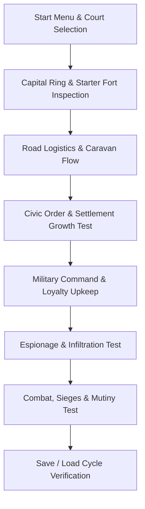

# Developer Setup & Playtesting Guide 🛠️🎮

This guide provides instructions for setting up the Rust toolchain via `rustup` across Windows, Linux, and macOS, followed by a manual playtesting protocol to test gameplay mechanics, UI responsiveness, and engine stability.

---

# Part 1: Installing Rust via `rustup`

Node Empire requires **Rust 1.85+ (Stable)**. We strongly recommend installing Rust via the official toolchain installer: **[`rustup`](https://rustup.rs/)**.

---

### 🪟 Windows Setup

#### 1. Install C++ Build Tools (Prerequisite)
Bevy and Rust on Windows require the MSVC C++ linkers:
- Download the **[Visual Studio Build Tools](https://visualstudio.microsoft.com/visual-cpp-build-tools/)**.
- In the installer, select the workload: **"Desktop development with C++"** (includes MSVC compiler and Windows SDK).
- Complete installation and reboot if prompted.

#### 2. Install `rustup`
1. Download **[`rustup-init.exe`](https://win.rustup.rs/)** (64-bit).
2. Run `rustup-init.exe` in your terminal or Command Prompt.
3. When prompted, press `1` (Proceed with installation - default).
4. Restart your terminal (PowerShell or Command Prompt).

#### 3. Verify Installation
```powershell
rustc --version
cargo --version
rustup target list --installed
```

---

### 🐧 Linux Setup (Ubuntu / Debian / Fedora / Arch)

#### 1. Install System Development Libraries
Bevy requires graphics, windowing, and input libraries.

**Ubuntu / Debian / Mint:**
```bash
sudo apt update
sudo apt install -y build-essential pkg-config libudev-dev libasound2-dev \
                    libwayland-dev libxkbcommon-dev libx11-dev
```

**Fedora / RHEL:**
```bash
sudo dnf groupinstall -y "Development Tools"
sudo dnf install -y pkg-config systemd-devel alsa-lib-devel \
                    wayland-devel libxkbcommon-devel libX11-devel
```

**Arch Linux / Manjaro:**
```bash
sudo pacman -Syu --needed base-devel pkgconf alsa-lib systemd-libs wayland libxkbcommon libx11
```

#### 2. Install `rustup`
Run the official installation script:
```bash
curl --proto '=https' --tlsv1.2 -sSf https://sh.rustup.rs | sh
```
- Select `1` (default installation).
- Source the environment in your shell:
```bash
source "$HOME/.cargo/env"
```

#### 3. Verify Installation
```bash
rustc --version
cargo --version
```

---

### 🍎 macOS Setup (Apple Silicon / Intel)

#### 1. Install Xcode Command Line Tools
Open Terminal and install the Apple C/C++ clang toolchain:
```bash
xcode-select --install
```
Follow the graphical prompt to finish installation.

#### 2. Install `rustup`
Run the installation script in Terminal:
```bash
curl --proto '=https' --tlsv1.2 -sSf https://sh.rustup.rs | sh
```
- Select `1` (default installation).
- Reload environment:
```bash
source "$HOME/.cargo/env"
```

#### 3. Verify Installation
```bash
rustc --version
cargo --version
```

---

### ⚙️ Recommended Developer Tooling (All Platforms)

Ensure `clippy` and `rustfmt` are installed for code formatting:
```bash
rustup component add clippy rustfmt
```

---

# Part 2: Building and Testing the Game

### 1. Headless Test Verification (1 Second)
Verify that your CPU and toolchain compile the game engine without issues:
```bash
cargo test
```
*Expected: 30+ tests passing across all suites.*

### 2. Launching the Game
Always run with the `--release` flag or the optimized dev profile:
```bash
cargo run --release
```
*(Debug mode without optimization will feel sluggish because Bevy and egui perform extensive matrix and mesh transformations.)*

---

# Part 3: Manual Playtesting Protocol

Use this checklist to playtest and verify gameplay systems, balance curves, and UI responsiveness.



---

## 🎮 Controls & Shortcuts

| Action | Control |
| :--- | :--- |
| **Pan Camera** | `W`, `A`, `S`, `D` or **Middle-Click Drag** or **Right-Click Drag** |
| **Zoom View** | **Mouse Wheel** (zooms toward mouse cursor) |
| **Select / Inspect Node** | **Left Click (LMB)** |
| **Deselect / Cancel Tool** | **Right Click (RMB)** or `Esc` |
| **Select Tool** | `V` |
| **Road Tool** | `R` |
| **Simulation Speed** | `Space` (Pause), `1` (1x), `2` (2x), `3` (4x) |
| **Quick-Save** | `0` (Saves to Quick Slot 1) |
| **In-Game Help Overlay** | `H` |
| **Pause / Game Menu** | `Esc` |

---

## 📋 Comprehensive Playtest Checklist

### 1. Main Menu & Court Selection
- [ ] Launch with `cargo run --release`. Verify procedural terrain renders smoothly with animated shimmer.
- [ ] Test keyboard hotkeys `1` to `6` to switch factions:
  - `1`: Silk Spinners (Espionage / Silk Loom bonuses)
  - `2`: Breplid Clans (High combat prowess / Fort defense)
  - `3`..`6`: Other courts.
- [ ] Press `Enter` or click **"Start New Realm"**.

### 2. Starter Ring & General Verification
- [ ] **Capital Inspection**: Confirm Capital is placed on passable land with starting pop (~30), food (~60), and gold (~300).
- [ ] **Starter Ring**: Verify pre-placed Farm, Woodcamp, and Mine surrounding the capital with pre-connected roads.
- [ ] **Starter Fort & General**:
  - Click on the frontier Fort.
  - Inspect the right panel under **Node**: Verify a General (*e.g., General Kaelen*) is stationed with high Loyalty (90) and command stats.
  - Confirm a starting garrison (5 soldiers) is stationed.

### 3. Road Logistics & Caravan Flow
- [ ] Press `R` to select the **Road Tool**.
- [ ] Click and drag between an unlinked node and your capital.
- [ ] Observe the A* route preview (white line) avoiding impassable water/mountains.
- [ ] Left-click to confirm placement (gold cost deducted).
- [ ] Confirm animated caravan dots begin traveling along the road to transfer resources.

### 4. Economy, Employment & Settlement Growth
- [ ] Open the **Realm Tab** on the right.
- [ ] Check **Public Order** and **Happiness**:
  - Base order is 32 + (0.6 × employment %) + 20 (Fort supply link).
  - Confirm that once happiness > 55 and order > 40, population growth begins ticking upward.
- [ ] Station workers at the Farm and Mine: verify output increases and worker experience ticks up.

### 5. Generals, Salaries & Mutiny Testing
- [ ] Speed up simulation to 2x (`2`) or 4x (`3`).
- [ ] Observe the gold ledger: every 100 ticks, general salaries are deducted.
- [ ] **Mutiny Stress Test**:
  - Spend treasury down to 0 gold by building roads or recruiting spies.
  - Confirm that wage default causes the general's loyalty to decay (-2 per cycle).
  - If loyalty drops below 20, check if mutiny warning toasts fire.

### 6. Espionage & Covert Ops
- [ ] In the Realm or Settlement menu, hire a **Spy** (75 gold).
- [ ] Send the spy to infiltrate an enemy or neutral settlement.
- [ ] Cycle through covert operations:
  - `Infiltrate`: Gather intelligence on enemy stock.
  - `Siphon`: Steal treasury/food.
  - `Sabotage`: Damage enemy production.
  - `Incite`: Lower public order.
- [ ] Check if the spy is detected by foreign counter-intelligence.

### 7. Combat & Siege Warfare
- [ ] Select a Fort with soldiers (> 6).
- [ ] Issue an attack order on an enemy or bandit settlement.
- [ ] Verify combat calculation:
  - Troops commanded by higher leadership general deal more damage.
  - Defense bonuses from fort equipment tiers reduce casualties.
- [ ] Confirm victory condition meters at the top bar update upon settlement capture.

### 8. Save / Load Integrity Cycle
- [ ] Press `0` to trigger a Quick-Save.
- [ ] Make radical changes (build roads, change tools).
- [ ] Press `Esc` $\to$ **Load Game** $\to$ Slot 1.
- [ ] Confirm world reconstructs with identical positions, general stats, and node inventories.

---

## 🔍 In-Engine Diagnostics & Debug Mode

When auditing systems or tracking schedule race conditions, run with diagnostic flags:

```bash
# Enable schedule ambiguity detection and verbose logging:
NODE_EMPIRE_AUDIT=1 cargo run --release

# Run simulation stress test without graphics:
cargo test --test sim_stress -- --nocapture
```
